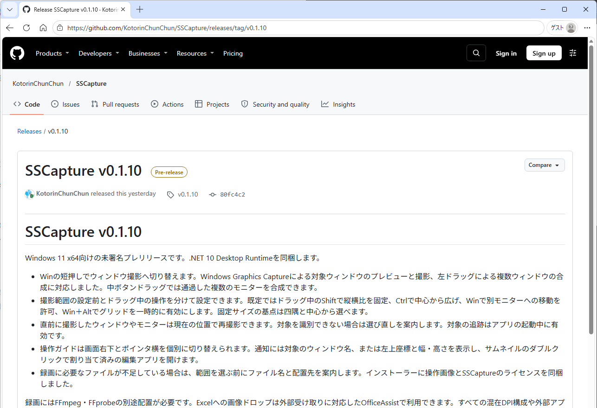
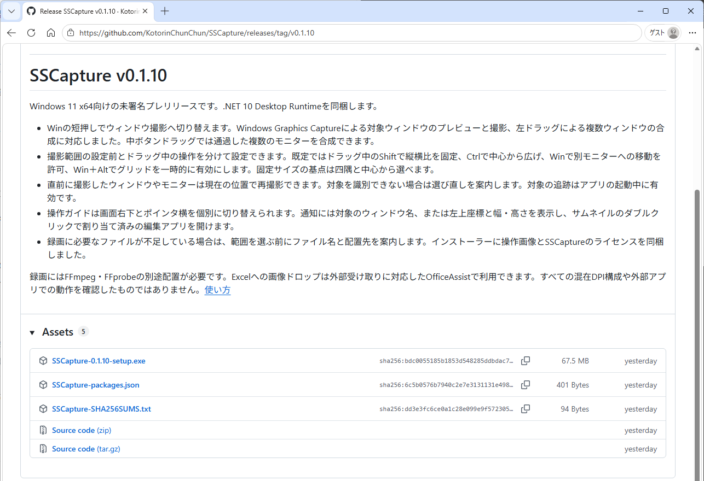
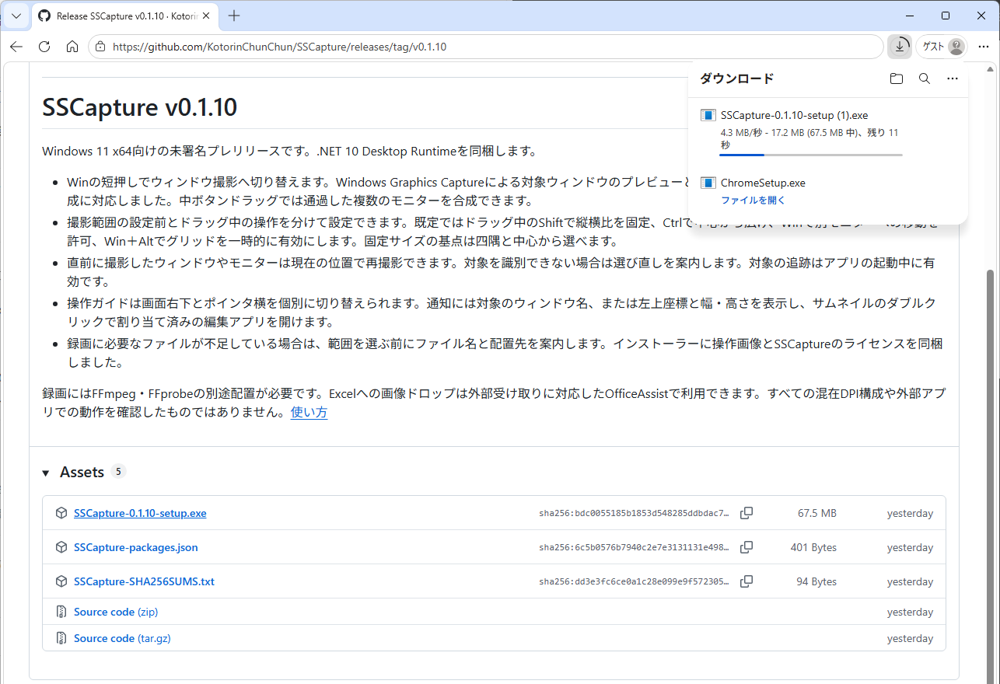
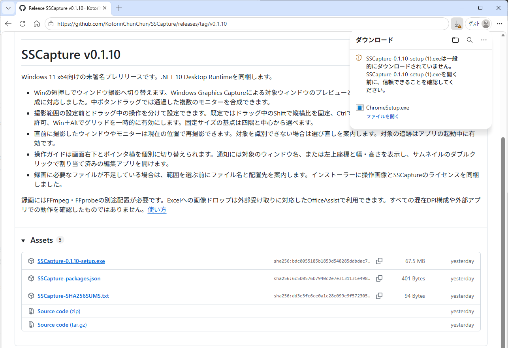
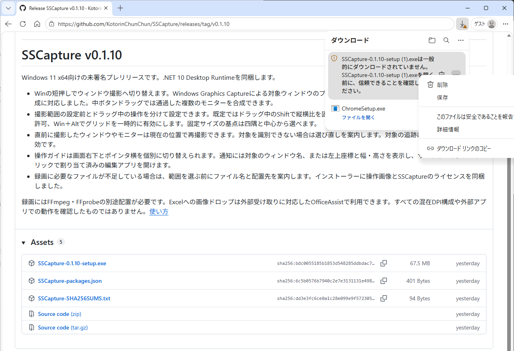
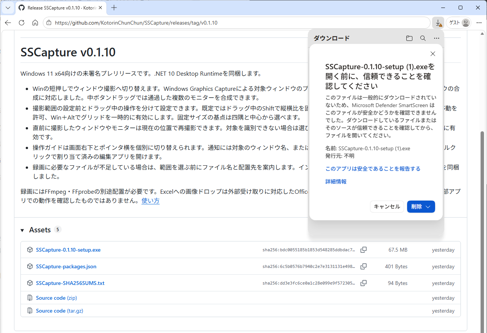
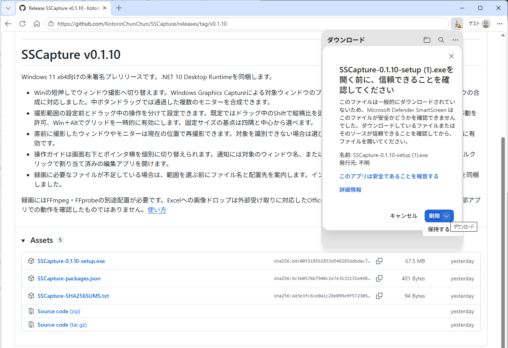
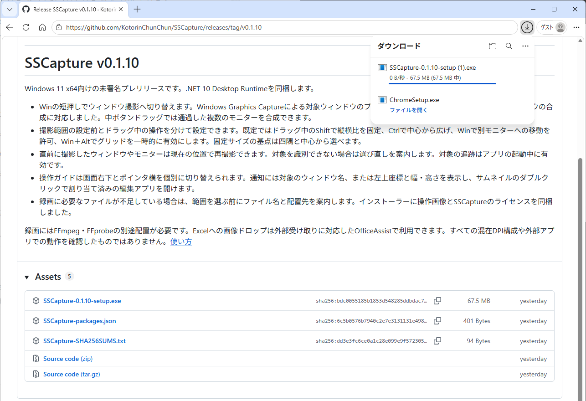

# GitHub Releasesからダウンロードする

KotorinToysや各アプリのインストーラーを、GitHub Releasesから手動で入手する手順です。画面はMicrosoft Edgeで [SSCapture v0.1.10](https://github.com/KotorinChunChun/SSCapture/releases/tag/v0.1.10) を開いたときの例です。

## 1. 使いたいアプリのリリースを開く

本体を入れる場合は [KotorinToysのReleases](https://github.com/KotorinChunChun/KotorinToys/releases) を開きます。各アプリは、KotorinToysの一覧で選んで「GitHubを開く」を押し、そのリポジトリで「Releases」を開きます。

リポジトリ名とバージョンを確認し、リリースの説明で対応するWindowsや注意事項を確認します。「Pre-release」は開発版です。



## 2. Assetsから配布ファイルを選ぶ

リリースの説明の下にある **Assets** を開き、説明に記載されたWindows用の配布ファイルをクリックします。本体なら `KotorinToys-<バージョン>-setup.exe`、画像の例なら `SSCapture-0.1.10-setup.exe` です。

アプリによってはMSIXやポータブル用ZIPが配布されます。「Source code (zip)」「Source code (tar.gz)」は開発用のソース一式です。



Edge右上のダウンロードアイコンから進み具合を確認できます。警告なしで保存できたら、[保存したファイルを確認する](#4-保存したファイルを確認する)へ進みます。



## 3. Edgeで保存の確認が出た場合

「一般的にダウンロードされていません」は、Edgeがファイルの安全性を判断できなかったときの警告です。配布元がアプリの公式GitHubリポジトリで、ファイル名とバージョンが説明に合っていることを確認してから進みます。危険なファイルとしてブロックされた場合や、配布元が分からない場合は操作を中止してください。 [香川大学のEdgeダウンロード手順（PDF）](https://eisc.kagawa-u.ac.jp/wp-content/uploads/sites/2/2026/05/Edge_TrustError_DownloadFix_202508.pdf)



1. ダウンロード一覧で対象ファイルにカーソルを合わせ、その行の **「…」→「保存」** を押します。

   

2. 確認画面でファイル名と発行元の表示を確認します。例のSSCapture v0.1.10はリリース説明に未署名と明記されているため、「発行元: 不明」と表示されています。表示がリリースの説明と合うか確認してください。

   

3. 保存する場合は **「削除」の右にある下向き矢印** を押し、**「保持する」** を選びます。Edgeのバージョンによって表示の位置が異なることがあります。

   

4. ダウンロード一覧に戻るので、保存が完了するまで待ちます。

   

## 4. 保存したファイルを確認する

Edgeのダウンロード一覧から保存先を開きます。同名のファイルがすでにあると、画像のようにファイル名に `(1)` が付くことがあります。今回保存したファイルを確認してください。

同じリリースのAssetsにあるSHA-256一覧で、配布ファイルに対応するハッシュを確認します。PowerShellで保存したファイルの実際のパスを指定し、表示されたハッシュが一覧の値とすべて一致することを確かめます。一致しない場合はファイルを開かず、公式ページから取得し直してください。

```powershell
Get-FileHash -Algorithm SHA256 -LiteralPath "$env:USERPROFILE\Downloads\SSCapture-0.1.10-setup (1).exe"
```

照合できたら、インストールやZIPの展開は各アプリのリリース説明に従います。
